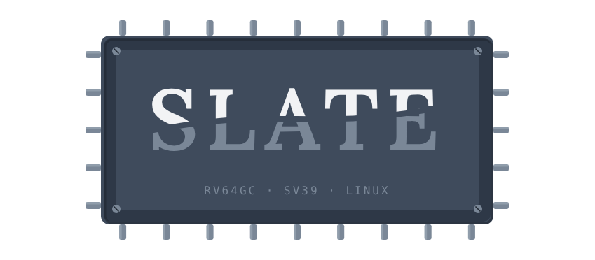

  

  <b>An RV64GC emulator in C++20 that boots unmodified Linux.</b>

  C++20 &middot; CMake &middot; RV64IMAFDC &middot; Sv39 &middot; OpenSBI

  Mert Isik &middot; <a href="https://github.com/packageIncoming">github.com/packageIncoming</a> &middot; <a href="https://linkedin.com/in/mert-c-isik">linkedin.com/in/mert-c-isik</a> &middot; mertisik329@gmail.com

